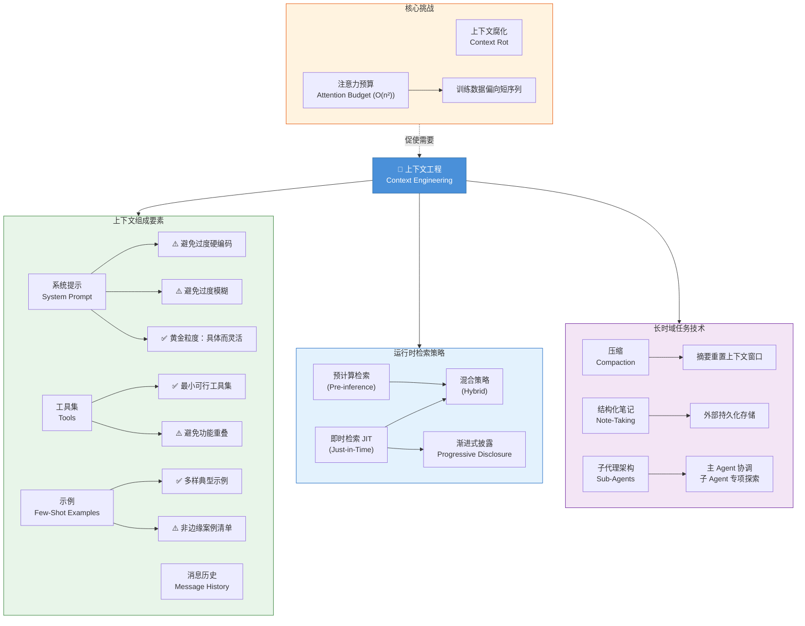

> **原文**：[Effective context engineering for AI agents](https://www.anthropic.com/engineering/effective-context-engineering-for-ai-agents)  
> **作者**：Anthropic Applied AI Team（Prithvi Rajasekaran, Ethan Dixon, Carly Ryan, Jeremy Hadfield 等）  
> **整理**：Claudian · 2026-04-10

---

## 核心概念

> **上下文工程（Context Engineering）** = 在 LLM 推理时，对进入上下文窗口的 Token 集合进行**策略性筛选与维护**，以一致地产生期望行为。

它是**提示工程（Prompt Engineering）的自然演进**：

| 维度 | 提示工程 | 上下文工程 |
|------|---------|-----------|
| 关注点 | 怎么写好 Prompt | 什么信息进入上下文 |
| 时机 | 预先静态设计 | 每次推理动态筛选 |
| 范围 | 主要是系统提示 | 系统提示 + 工具 + 历史 + 外部数据 + MCP 等 |
| 适用场景 | 单次分类/生成 | 多轮、长时域 Agent |

---

## 为什么上下文工程至关重要？

### 上下文腐化（Context Rot）

LLM 并非对所有 Token 一视同仁。研究表明，随着上下文长度增加，模型从中检索信息的准确性**持续下降**。

### 注意力预算（Attention Budget）

- Transformer 架构：每个 Token 都要与其他所有 Token 进行注意力计算，复杂度为 **O(n²)**
- 上下文越长，注意力越"稀释"，等同于人类的**工作记忆容量限制**
- 训练数据以短序列为主 → 模型对长序列依赖关系的学习经验相对不足

> **核心结论**：上下文是**有限资源**，边际收益递减。必须精心筛选。

---

## 有效上下文的解剖

### 原则：最小高信号 Token 集

> *找到能最大化期望结果可能性的、最小的高信号 Token 集合。*

### 1. 系统提示（System Prompts）

**两种失败极端**：

```
过度具体（脆弱）          ←──── 黄金地带 ────→          过于模糊（无效）
硬编码 if-else 逻辑                              假设共享上下文
维护成本高                                      缺乏具体信号
```

**最佳实践**：
- 使用 XML 标签或 Markdown 标题分节（`<background_information>`, `<instructions>` 等）
- 追求"**足够少但足够完整**"的信息量
- 从最简提示 + 最好模型开始测试，再根据失败案例补充

### 2. 工具（Tools）

- 定义了 Agent 与信息/行动空间的**契约**
- 工具应**自包含、健壮、语义清晰**，类似设计良好的代码库中的函数
- **常见失败模式**：工具集过大、功能重叠 → 决策歧义
- 原则：最小可行工具集（Minimal Viable Tool Set）

### 3. 示例（Few-Shot Examples）

- 图例胜千言——LLM 的"图片"
- **不要**塞满边缘案例清单
- **推荐**：精选多样化、典型的行为示例

---

## 上下文检索策略

### 三种模式对比

```
预计算检索                即时检索 (JIT)              混合策略
Pre-inference             Just-in-Time               Hybrid
─────────────            ─────────────              ─────────────
嵌入向量 + 向量库          运行时动态加载               两者结合
速度快                    避免过时索引                 按需切换
可能检索无关内容            探索开销更大                 最灵活
```

### 即时检索的优势

Agent 维护轻量级**引用标识符**（文件路径、查询、URL 等），运行时按需加载数据：

- **类比人类认知**：我们不记忆整个语料库，而是用文件系统、收件箱等外部索引系统
- **渐进式披露（Progressive Disclosure）**：逐层发现上下文
  - 文件大小 → 暗示复杂度
  - 命名约定 → 暗示用途
  - 时间戳 → 作为相关性代理

> **实例**：Claude Code 使用 glob/grep 即时导航，CLAUDE.md 预置入上下文，两者结合。

---

## 长时域任务技术

当任务跨越数十分钟乃至数小时，Token 数量超出上下文窗口时，需要专门策略：

### 技术一：压缩（Compaction）

```
原始对话历史（接近窗口上限）
         ↓ 模型总结压缩
    精炼摘要 + 最近5个文件
         ↓ 重新初始化
    新上下文窗口（继续工作）
```

**保留**：架构决策、未解决的 Bug、实现细节  
**丢弃**：冗余的工具输出、重复消息

**调优建议**：先最大化召回率，再迭代提升精确率

### 技术二：结构化笔记（Structured Note-Taking）

- Agent 定期将关键信息写入**上下文窗口之外的持久存储**（如 NOTES.md、todo 列表）
- 后续推理时按需拉回上下文
- **示例**：Claude 玩宝可梦——跨数千步维护目标追踪、地图探索记录、战斗策略笔记

### 技术三：子代理架构（Sub-Agent Architecture）

```
主 Agent（协调者）
  ├── 维护高层计划
  ├── 汇总子代理结果（1000-2000 Token）
  │
  ├── 子 Agent A（专项任务，独立上下文）
  │     └── 深度探索，可消耗数万 Token
  ├── 子 Agent B
  └── 子 Agent C
```

**优势**：关注点分离，每个子 Agent 拥有干净的上下文窗口

### 技术选型参考

| 场景 | 推荐技术 |
|------|---------|
| 需要大量来回交互的任务 | 压缩（保持对话流畅） |
| 有清晰里程碑的迭代开发 | 结构化笔记 |
| 复杂研究 / 并行探索任务 | 子代理架构 |

---

## 关键结构关系图



---

## 核心原则总结

> **最小高信号 Token 原则**：在 LLM 推理的每一步，找到能最大化期望结果可能性的最小高信号 Token 集合。

1. **上下文是有限资源** → 精心筛选，避免污染
2. **系统提示要在"过度具体"与"过度模糊"之间找到黄金粒度**
3. **工具集要最小化，语义清晰不重叠**
4. **示例要典型多样，而非穷举边缘情况**
5. **长时域任务**：压缩 → 笔记 → 子代理，按需选型
6. **随着模型能力提升**，工程约束会减少，但"上下文是珍贵资源"的原则长期有效
